# 로그인 워치독 (login-watchdog)

[](https://github.com/dyj02056/login-watchdog/actions/workflows/tests.yml)


로그인 공격을 **탐지 → 판단 → 대응 → 복구**까지 처리하는 보안 관제 데모 프로젝트입니다. 애플리케이션 계층(L7) 공격을 위험등급별로 막는 데서 시작해, **Track D**에서 네트워크·전송 계층(L3/L4) 탐지와 차단까지 넓혔습니다.

**배포 주소** https://login-watchdog.vercel.app · **코드 흐름도** https://dyj02056.github.io/login-watchdog/ · **[문서 지도](#문서-지도)**

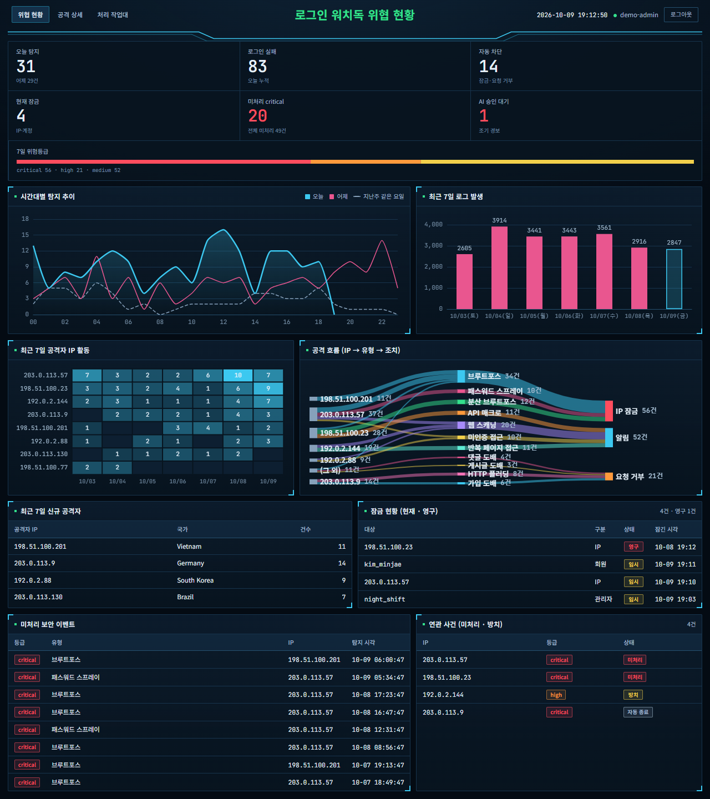

## 한눈에 보기

| | |
|---|---|
| **막는 공격** | 브루트포스·패스워드 스프레이·분산 브루트포스, 가입·글·댓글 도배, 웹 스캐닝, 매크로/봇, HTTP 플러딩, SYN Flood·포트 스캔 |
| **판단 방식** | 위험등급 4단계(CRITICAL/HIGH/MEDIUM/LOW), SIEM 상관분석(사건으로 묶기), 교차 규칙 NET-01·CR-01~03, LLM 조기 경보 |
| **대응** | IP/계정 임시 잠금 → 반복 시 영구 잠금, SOAR 플레이북, 정문에서 L4 차단(탐지→차단 2~3초대, 10/29 S5 중앙값 2.7초), L3 경보(ICMP·위조 출발지)는 주소 차단 없이 알림·속도 제한, Slack·메일 알림 |
| **복구** | 이메일 인증으로 본인 잠금 해제, 비밀번호 찾기·변경, 관리자 해제(역할별 권한) |
| **관제** | Next.js 관제 보드 3개(위협 현황·공격 상세·처리 작업대), RBAC 3역할 |
| **규모** | Supabase 표 35개 · pytest 1,484개 통과 · 시연 시나리오 S4~S9 7개 모두 PASS(S7 위조 출발지·S9 ICMP 폭주 포함) — S4는 차단 적용(`APPLIED`)과 실제 접속 차단까지 확인 (2026-10-29 기준) |

## 구조

<p align="center">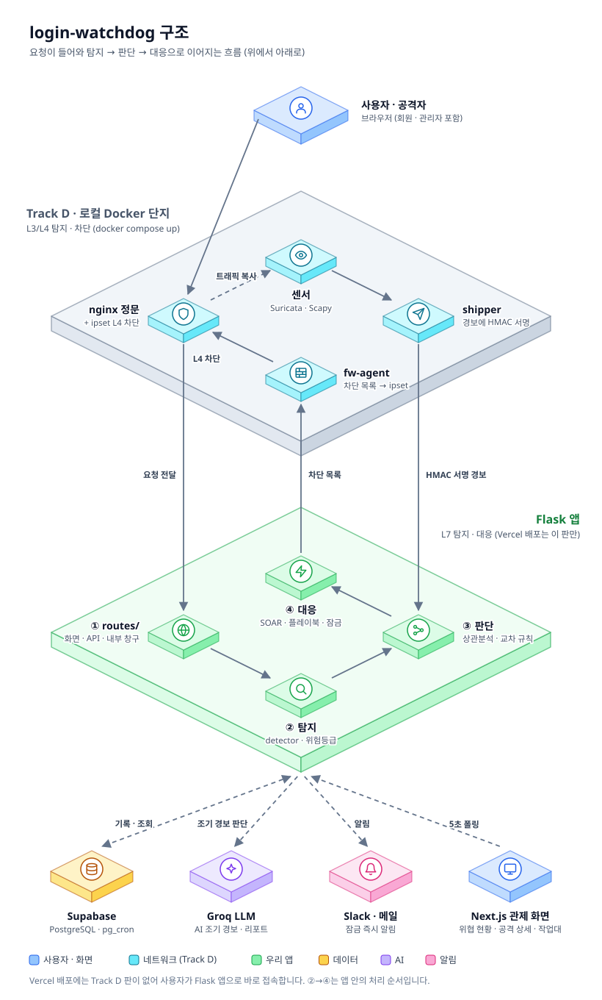</p>

- **L7 경로**: 모든 요청이 Flask 앱에서 탐지 → 상관분석 → 대응을 거칩니다. Vercel 배포에서는 이 경로만 동작합니다.
- **L3/L4 경로**(Track D): 정문 앞 센서가 본 경보가 서명된 채 앱으로 들어오고, 앱이 앱 기록과 엮어 판단한 뒤 fw-agent가 정문에서 L4로 막습니다. `docker compose up`으로 켭니다 → [netwatch/README.md](netwatch/README.md)

## 기능

| 계층 | 기능 | 한 줄 설명 | 해설 |
|---|---|---|---|
| **탐지** | 브루트포스 자동 잠금 | 같은 IP가 60초 안에 5회 넘게 실패하면 5분 잠금 | [21](docs/beginner-guide/guide21_anomaly_detection.md) |
| | 통합 위험등급 | 모든 공격을 `security_events`에 CRITICAL~LOW 등급으로 기록 | [22](docs/beginner-guide/guide22_security_grading.md) |
| | L7 방어 보강 | 계정 단위 잠금, 보안 헤더·HTTP 플러딩 한도, 허니팟, SSRF·오픈 리다이렉트 방어 | [24](docs/beginner-guide/guide24_l7_attack_hardening.md) |
| | 매크로/봇 탐지 | 60초 안에 서로 다른 `/api/*` 경로 5개 초과 호출 시 관찰 | [29](docs/beginner-guide/guide29_macro_bot_detection.md) |
| | 관리자 계정 잠금 | `/admin/login`도 계정 단위로 잠금(15분 8회 초과) | [38](docs/beginner-guide/guide38_admin_account_lockout.md) |
| | IPv6 /64 대역 단위 | IPv6는 주소가 아니라 /64 대역으로 세고 잠금 | [42](docs/beginner-guide/guide42_ipv6_prefix.md) |
| | 네트워크 센서 (Track D) | Suricata·Scapy가 SYN Flood·포트 스캔·스캐너 요청 탐지 | [51](docs/beginner-guide/guide51_network_sensor.md) |
| **판단** | SIEM 상관분석 | 같은 IP의 서로 다른 이벤트를 하나의 사건으로 묶고 관리자가 해결 처리 | [27](docs/beginner-guide/guide27_siem_correlation.md) · [32](docs/beginner-guide/guide32_incident_resolution.md) |
| | 교차 규칙 (Track D) | NET-01(SYN 폭주), CR-01(정찰→침투), CR-02(SYN+HTTP), CR-03(의심 주소의 로그인 성공 차단) | [52](docs/beginner-guide/guide52_net_ingest_correlation.md) |
| | LLM 조기 경보 | 기준 직전 구간을 Groq에게 물어 위험하면 관리자 승인 대기로 올림 | [31](docs/beginner-guide/guide31_llm_judgment_agent.md) |
| **대응** | SOAR 플레이북 | 복합 공격 에스컬레이션 알림, Track D 규칙별 단계 실행·기록 | [28](docs/beginner-guide/guide28_soar_playbook.md) · [53](docs/beginner-guide/guide53_playbook_engine.md) |
| | 영구 잠금 | 30일 안에 두 번째 잠금이거나 CRITICAL 사건이면 자동 만료 없는 잠금으로 승격 | [33](docs/beginner-guide/guide33_permanent_lock.md) |
| | L4 차단 (Track D) | fw-agent가 정문 ipset에 넣고 빼서 차단, 위조 가능한 증거는 시간 제한 차단만 | [54](docs/beginner-guide/guide54_l4_block_agent.md) |
| | 예외 상황 보완 (Track D) | 위조 요청이 수집 한도를 못 쓰게, 통신 끊김 중 TTL 만료, ACK 요청 번호, 실패 단계만 재실행, L7·L4 해제 결과 분리 (10/26 강사 피드백) | [56](docs/beginner-guide/guide56_feedback_hardening.md) |
| | 차단 신뢰성·L3 탐지 (Track D) | 인프라 주소 위조 차단 방지, 적용 실패 재시도·알림, 규칙·센서·폴링 이상 알림, ICMP·위조 출발지·전체 SYN 경보와 ICMP 속도 제한, 정문 용량, S7·S9 자동 점검 | [57](docs/beginner-guide/guide57_reliability_l3.md) |
| | 알림 | Slack(등급 표시)과 메일 | [07](docs/beginner-guide/guide07_alert.md) |
| **복구** | 이메일 인증 해제 | 잠긴 계정·IP를 본인 메일 인증으로 해제(본인 기기에만 예외) | [34a](docs/beginner-guide/guide34a_email_recovery.md) · [43](docs/beginner-guide/guide43_recovery_request_limit.md) |
| | 이메일 인증·변경 보호 | 인증 링크, 비밀번호 + 새 주소 확인을 거쳐야 이메일 변경 | [40](docs/beginner-guide/guide40_email_verification.md) |
| | 비밀번호 찾기·변경 | 인증된 이메일로만 재설정, 바꾸면 다른 기기 로그인 해제 | [41](docs/beginner-guide/guide41_password_reset.md) · [35](docs/beginner-guide/guide35_password_change.md) |
| | 계정 존재 노출 방지 | 잠금·복구 응답의 문구와 응답 시간을 똑같이 맞춤 | [39](docs/beginner-guide/guide39_account_enumeration.md) |
| **관제** | Next.js 관제 보드 | 위협 현황·공격 상세·처리 작업대, 보이는 탭만 폴링·표 단위 갱신 | [48](docs/beginner-guide/guide48_nextjs_dashboard.md) · [45](docs/beginner-guide/guide45_visible_tab_polling.md) · [46](docs/beginner-guide/guide46_dashboard_responsiveness.md) |
| | 관리자 RBAC | `security_viewer` / `security_admin` / `super_admin` 액션 단위 권한 | [26](docs/beginner-guide/guide26_rbac_foundation.md) · [37](docs/beginner-guide/guide37_session_and_code_hardening.md) |
| | 회원 화면·게시판 | 회원 대시보드(로그인 기록·위치), 게시판·댓글 | [13](docs/beginner-guide/guide13_member.md) · [14](docs/beginner-guide/guide14_geoip.md) · [20](docs/beginner-guide/guide20_board.md) |
| **운영** | 로그 정리·일별 요약 | pg_cron이 매일 어제 요약 후 보관 기간 지난 기록 삭제 | [44](docs/beginner-guide/guide44_log_retention.md) · [47](docs/beginner-guide/guide47_daily_log_summary.md) |
| | 리포트·튜닝 | 일일 리포트(AI 총평), 임계값 오탐 점검 리포트 | [25](docs/beginner-guide/guide25_scripts_merge_ai_report.md) · [30](docs/beginner-guide/guide30_threshold_tuning.md) |
| | 배포 안정화·데모 데이터 | 서버리스 DB 연결 재시도, 7일치 샘플 로그 데모 서버 | [36](docs/beginner-guide/guide36_db_connection.md) · [50](docs/beginner-guide/guide50_demo_sample_logs.md) |

각 기능의 수치·예외·설정값은 **[docs/features.md](docs/features.md)** 에 있습니다. 해설 칸의 번호는 [단계별 해설서](docs/beginner-guide/beginner-guide.md)의 guide 번호입니다.

## 화면

| 공격 상세 `/admin/attack` | 처리 작업대 `/admin/ops` |
|---|---|
| 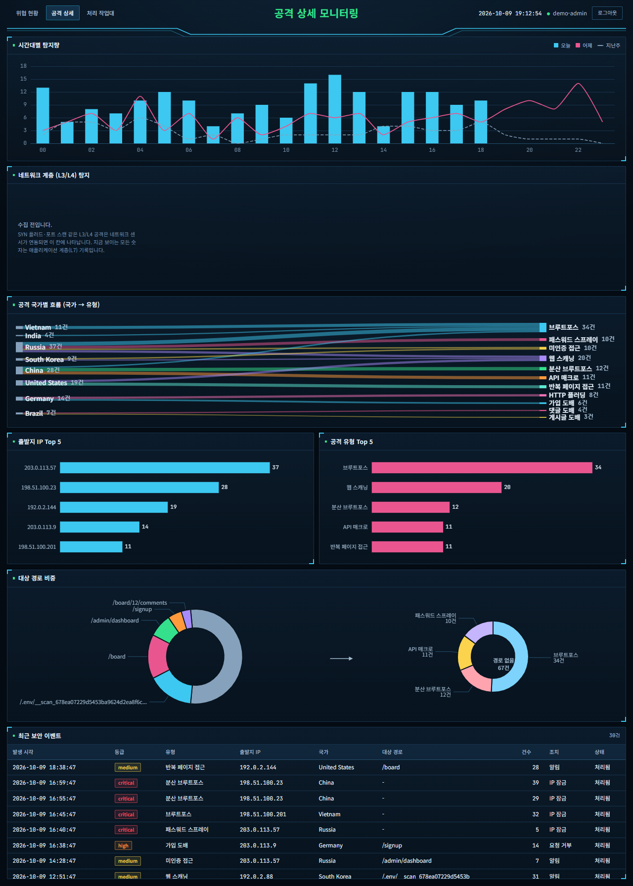 | 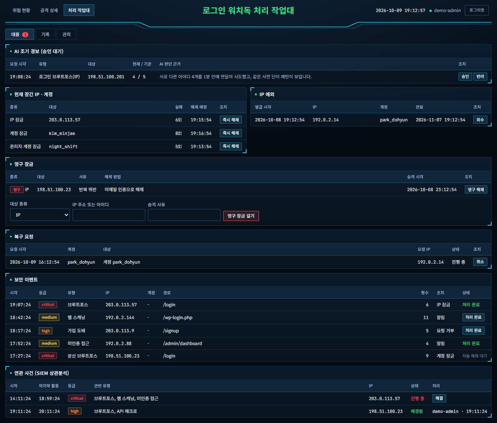 |

<details>
<summary>회원·게시판 화면 보기</summary>

| 로그인 | 회원가입 | 회원 대시보드 |
|---|---|---|
| 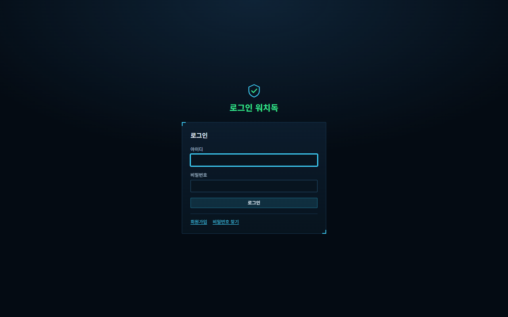 | 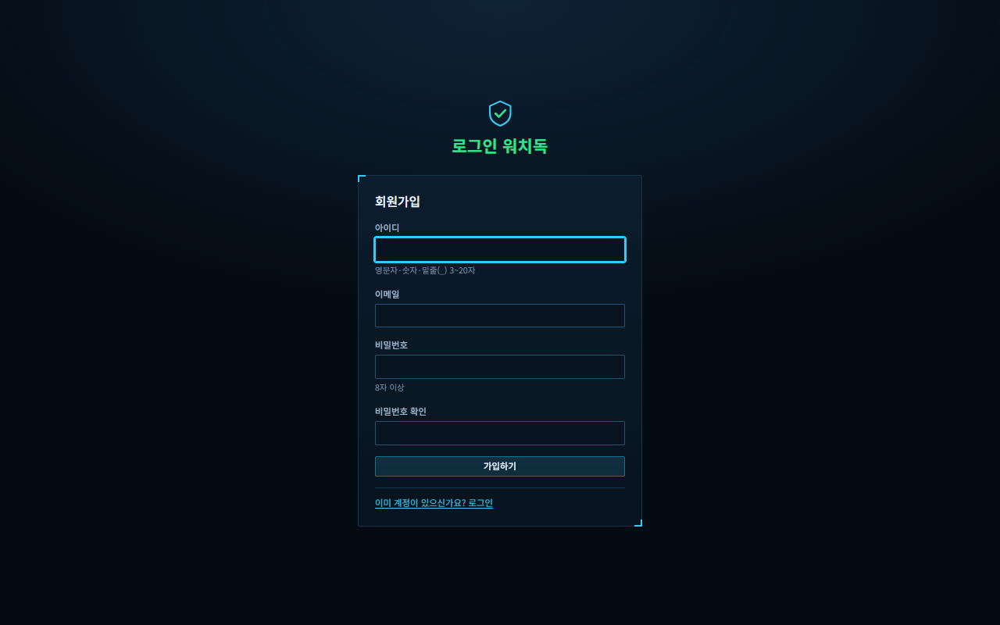 | 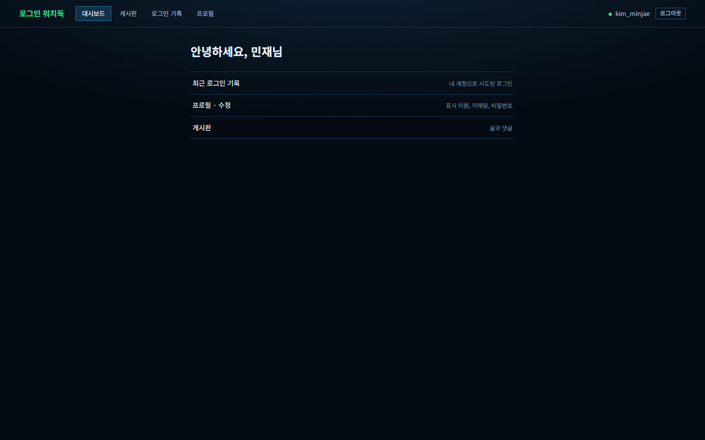 |
| **로그인 기록** | **프로필** | **게시판 목록** |
| 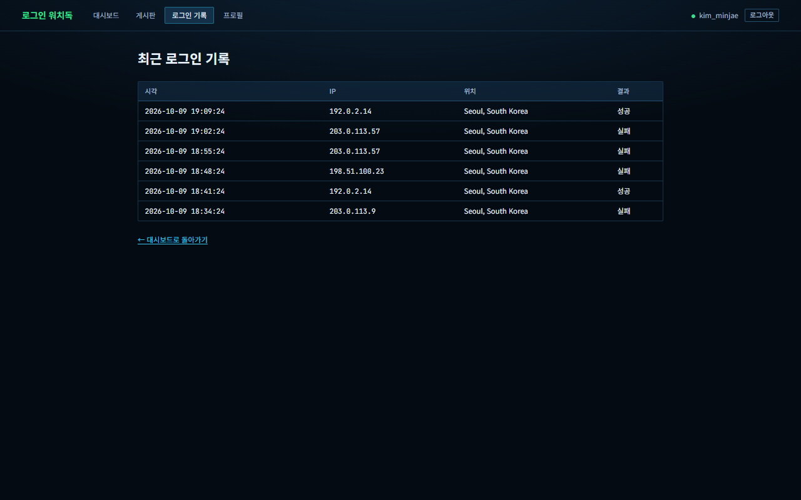 | 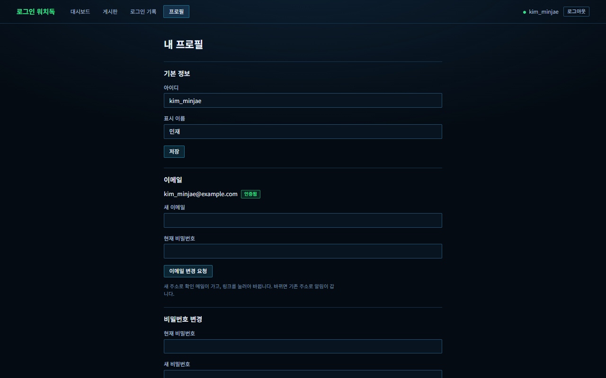 | 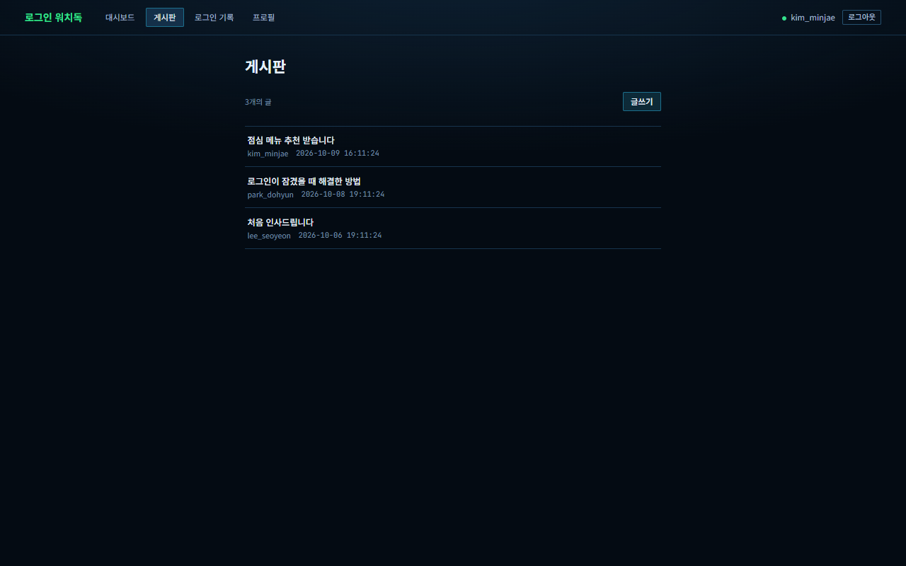 |
| **글쓰기** | **상세 · 댓글** | |
| 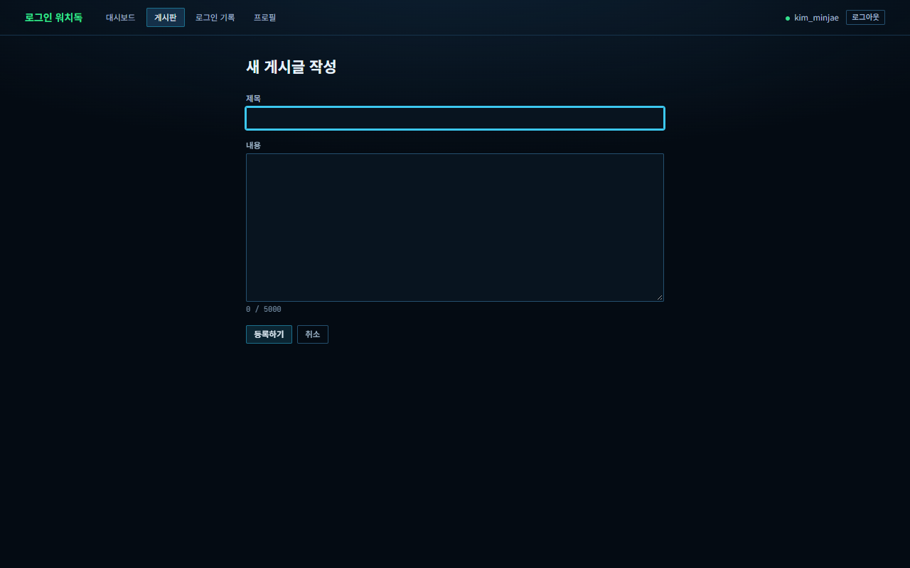 | 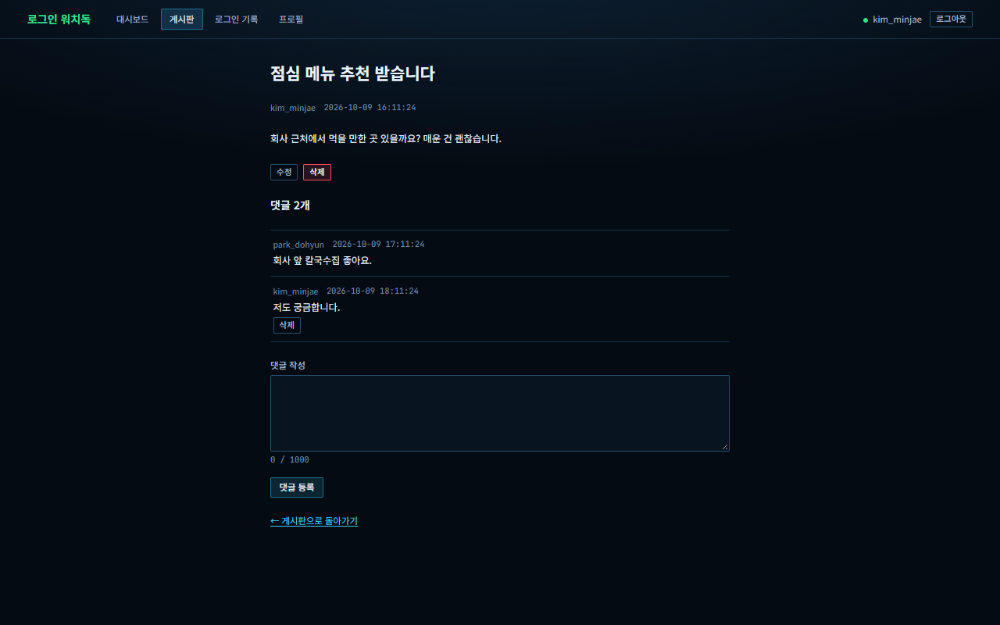 | |

</details>

> 관리자 화면 스크린샷은 데모 서버(`scripts/demo/demo_server.py`)의 가짜 데이터로 찍었습니다. 화면의 IP와 "공격자"는 실제 접속이 아닙니다.

## 기술 스택

| 영역 | 사용 기술 |
|---|---|
| 백엔드 | Flask (Blueprint), Flask-Limiter, Flask-WTF(CSRF) |
| 데이터베이스 | Supabase(PostgreSQL), pg_cron |
| 프런트엔드 | Next.js(React, TypeScript) 정적 내보내기, Apache ECharts — 없으면 Jinja 화면으로 자동 폴백 |
| 알림·외부 연동 | Slack Webhook, SMTP(Gmail·Mailpit), Groq LLM, ip-api.com |
| 네트워크 (Track D) | Docker Compose, nginx, Suricata 7, Scapy, iptables + ipset, gunicorn |
| 배포·테스트 | Vercel, GitHub Actions, pytest |

## 빠른 시작

```bash
git clone https://github.com/dyj02056/login-watchdog.git
cd login-watchdog
python -m venv venv && source venv/Scripts/activate   # PowerShell: .\venv\Scripts\Activate.ps1
pip install -r requirements.txt
cp .env.example .env   # SUPABASE_URL, SUPABASE_KEY, SECRET_KEY, ADMIN_USERNAME/PASSWORD 채우기
python app.py          # http://localhost:5000
```

1. Supabase SQL Editor에서 [docs/schema.sql](docs/schema.sql)을 실행합니다. 기존 DB라면 [docs/migrations/](docs/migrations)를 순서대로 실행해야 하며, **배포 전에** 실행해야 하는 파일이 있습니다.
2. Supabase 없이 관제 화면만 보려면 `python scripts/demo/generate_demo_logs.py` 다음 `python scripts/demo/demo_server.py`를 실행하고 http://127.0.0.1:5077/__demo_login 을 엽니다.
3. Track D(L3/L4)까지 켜려면 [netwatch/README.md](netwatch/README.md)를 따릅니다.

마이그레이션 순서, 환경변수 전체 표, 접속 주소 목록은 **[docs/setup.md](docs/setup.md)** 에 있습니다.

## 테스트·점검

```bash
pytest tests/ -q
```

- **단위 테스트**: 실제 Supabase에 접속하지 않고 monkeypatch로 판정 로직만 검증합니다. 1,484개가 통과합니다(Track D는 `tests/track_d/`).
- **공격 시뮬레이터**: `scripts/simulation/{critical,high,medium}/`, 일괄 점검은 `scripts/demo/check_simulations.py`
- **Track D 시나리오 채점**: `scripts/net/run_all.py`가 S4~S9를 채점합니다(S4 해제 후 재접속까지 보려면 `--with-release`), 측정 결과는 [measurements.md](docs/track-d/measurements.md)와 [scenario-results.md](docs/track-d/scenario-results.md)

스크립트별 옵션과 사용 예는 **[docs/scripts.md](docs/scripts.md)** 에 있습니다.

## 프로젝트 구조

```
login-watchdog/
├── app.py · config.py   # Flask 진입점 · 임계값과 설정 상수
├── routes/              # 화면·API 라우트 (auth, admin/, member, board, recovery, password, email, internal/=Track D 창구)
├── security/            # 보안 엔진: detector(탐지) → correlate(판단) → soar/·playbooks·lockdown·netblock(대응)
├── notify/              # Slack·메일 발송
├── services/            # LLM, IP 위치, 이메일 토큰, IP 정규화
├── helpers/             # 라우트 공용 함수 (세션·권한, 요청 IP, 보안 헤더 훅, SPA 서빙)
├── db/                  # Supabase 표 묶음별 모듈 (db.함수명()으로 호출)
├── web/                 # Next.js 화면 소스 → 빌드 결과 spa/ · public/_next/ (커밋 대상)
├── templates/           # 예전 Jinja 화면 (폴백)
├── netwatch/            # Track D 컨테이너: nginx, suricata, l4_detector, shipper, fw_agent, attacker
├── scripts/             # 터미널 도구: simulation/ · management/ · demo/ · net/ · docs/
├── tests/               # pytest (track_d/ 포함)
└── docs/                # 해설서·기능 레퍼런스·스키마·마이그레이션·Track D 계약서
```

파일 하나하나의 역할과 리팩터링 배경은 **[docs/project-structure.md](docs/project-structure.md)** 에 있습니다.

## 문서 지도

| 이런 분은 | 여기부터 보세요 |
|---|---|
| 처음 보는 분 | 이 README → [docs/scenario.md](docs/scenario.md) (시연 대본: 공격 → 탐지 → 대응 → 복구) |
| 기능을 자세히 알고 싶은 분 | [docs/features.md](docs/features.md) |
| 직접 실행해 보려는 분 | [docs/setup.md](docs/setup.md) → Track D는 [netwatch/README.md](netwatch/README.md) |
| 코드가 어떤 순서로 실행되는지 따라가려는 분 | [기능 순서](docs/feature-reference/01-feature-order.md) · [계층 순서](docs/feature-reference/02-layer-order.md) · [클릭형 흐름도](https://dyj02056.github.io/login-watchdog/) |
| 구현 과정을 처음부터 배우려는 분 | [단계별 해설서](docs/beginner-guide/beginner-guide.md) (guide01~54·56·57, 51~54·56·57이 Track D, 55는 작성 예정) |
| DB 표를 보려는 분 | [db-schema-guide.md](docs/feature-reference/db-schema-guide.md) · [ERD.svg](docs/feature-reference/ERD.svg) (ERD에는 Track D 표가 아직 없음) |
| Track D와 연동하려는 분 | [contracts.md](docs/track-d/contracts.md) (함수·주소·데이터 모양의 기준) |
| 화면을 고치려는 분 | [PRODUCT.md](PRODUCT.md) (디자인 원칙) · [web/README.md](web/README.md) (빌드) |
| 설계 이유가 궁금한 분 | [plan.md](plan.md) · [research.md](research.md) · [게시판 설계](docs/board-comment) · [리팩터링 기록](docs/refactor) · [폴더 지도](docs/architecture-map.html) |
| 시연을 준비하는 분 | [scenario.md](docs/scenario.md) · [VPN 시연](docs/vpn-demo-guide.md) · [웹 스캐닝 재현](docs/web-scanning-demo.md) |

## 알려진 제한사항

- **IP 단위 잠금**: 같은 공유 IP나 IPv6 /64 대역의 사용자는 함께 잠깁니다.
- **`TRUST_FORWARDED_FOR`는 데모 전용**: 켜 두면 헤더로 IP를 속여 잠금을 우회하거나 남의 IP를 잠글 수 있습니다.
- **L3/L4 대응은 로컬 Docker 단지에서만** 동작합니다. Vercel 배포에서는 L7 방어만 동작합니다.
- **위조될 수 있는 증거로는 주소를 영구로 막지 않습니다**: SYN·포트 스캔은 시간 제한 L4 차단까지, L3 경보(ICMP 폭주·위조 출발지·출발지를 바꾸는 SYN 폭주)는 기록·알림과 ICMP 속도 제한까지만 합니다. 우리 인프라 주소(core·gateway)는 어떤 경보로도 막지 않습니다.
- **대시보드는 실시간이 아니라 폴링**(기본 5초)이고, 자동 잠금 해제는 다음 요청이 올 때 처리됩니다.
- **`web/`을 고치면 빌드 결과(`spa/`, `public/_next/`)도 함께 커밋**해야 배포에 반영됩니다.

영구 잠금 해제 조건, 관리자 계정 예외, 게시판 범위 등 전체 목록은 **[docs/known-limitations.md](docs/known-limitations.md)** 에 있습니다.
